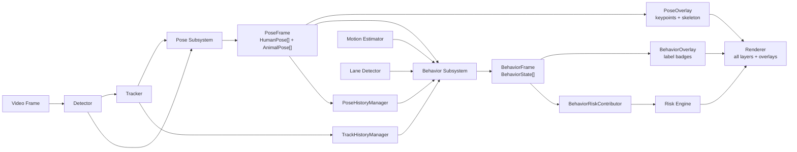

# Pose Estimation & Behaviour Classification Subsystem

## Architecture



**Data flow:**

1. `Frame` → `Detector` produces `Detection[]`
2. `Detection[]` → `Tracker` produces `TrackedObject[]`
3. `TrackedObject[]` + `Frame` → **PoseSubsystem** produces `PoseFrame`
   - Human poses via YOLOv8-Pose / RTMPose (COCO 17-keypoint order)
   - Animal poses via AP-10K HRNet (AP-10K 17-keypoint order)
4. `PoseFrame` + `PoseHistory` + `TrackHistory` + `Motion` + `LaneInfo` → **BehaviorSubsystem** produces `BehaviorFrame`
   - Human classifier: rule-based (standing, walking, running, fallen, distracted, crossing/approaching/leaving road)
   - Animal classifier: rule-based (standing, walking, running, lying, grazing, crossing/approaching road)
5. `BehaviorFrame` → **BehaviorRiskContributor** produces additive risk adjustments
6. `PoseFrame` → **PoseOverlay** renders keypoints + skeleton edges
7. `BehaviorFrame` → **BehaviorOverlay** renders compact label badges
8. All layers merged by **Renderer** into final annotated frame

---

## Configuration Reference

### Pose Estimation (`configs/pose.yaml` or `pose:` section in pipeline config)

| Key | Type | Default | Description |
|-----|------|---------|-------------|
| `enabled` | `bool` | `false` | Master toggle |
| `human.estimator` | `str` or `null` | `null` | `"yolov8_pose"` or `"rtmpose"` |
| `human.model_path` | `str` or `null` | `null` | Path to model weights (`.pt` or `.onnx`) |
| `human.device` | `str` | `"cpu"` | `"cpu"`, `"cuda:0"`, `"mps"` |
| `human.input_size` | `[int, int]` | `[640, 640]` | `[height, width]` for YOLOv8-Pose |
| `human.confidence_threshold` | `float` | `0.5` | Minimum keypoint confidence |
| `animal.estimator` | `str` or `null` | `null` | `"ap10k_hrnet"` |
| `animal.model_path` | `str` or `null` | `null` | Path to AP-10K model weights |
| `animal.device` | `str` | `"cpu"` | `"cpu"`, `"cuda:0"`, `"mps"` |
| `animal.input_size` | `[int, int]` | `[256, 256]` | `[height, width]` for HRNet |
| `animal.confidence_threshold` | `float` | `0.5` | Minimum keypoint confidence |
| `animal.supported_species` | `[str]` | `[]` | Allow-list of species; empty = all |
| `animal.class_to_species` | `{int: str}` | *(built-in)* | COCO class ID → species name |
| `max_persons` | `int` | `10` | Max human instances per frame |
| `max_animals` | `int` | `10` | Max animal instances per frame |

### Behaviour Classification (`configs/behavior.yaml` or `behavior:` section)

| Key | Type | Default | Description |
|-----|------|---------|-------------|
| `enabled` | `bool` | `false` | Master toggle |
| `human.classifier` | `str` or `null` | `"rule_based"` | Classifier backend |
| `human.speed.walking_min_mps` | `float` | `0.3` | Speed threshold for STANDING |
| `human.speed.running_min_mps` | `float` | `1.5` | Speed threshold for RUNNING |
| `human.fallen.torso_angle_threshold_deg` | `float` | `45.0` | Torso angle → FALLEN |
| `human.distracted.head_motion_angle_threshold_deg` | `float` | `60.0` | Head vs motion → DISTRACTED |
| `human.road.crossing_probability_high` | `float` | `0.7` | CP threshold → CROSSING |
| `human.road.approaching_distance_px` | `float` | `100.0` | Max pixel dist for APPROACHING |
| `human.road.approaching_angle_threshold_deg` | `float` | `45.0` | Heading angle for APPROACHING |
| `animal.classifier` | `str` or `null` | `"rule_based"` | Classifier backend |
| `animal.speed.walking_min_mps` | `float` | `0.2` | Speed threshold for STANDING |
| `animal.speed.running_min_mps` | `float` | `1.2` | Speed threshold for RUNNING |
| `animal.lying.torso_height_threshold` | `float` | `0.3` | Height fraction → LYING |
| `animal.grazing.head_down_angle_threshold_deg` | `float` | `45.0` | Nose below neck → GRAZING |
| `crossing_probability.decay_distance_px` | `float` | `50.0` | Exponential decay for CP |
| `crossing_probability.heading_weight` | `float` | `0.3` | Heading contribution to CP |
| `crossing_probability.speed_weight` | `float` | `0.2` | Speed contribution to CP |
| `risk_contribution.*` | `float` | *(various)* | Additive risk boost values |

### Visualisation Overlays (`configs/visualization.yaml` or `visualization:` section)

**Pose overlay:**

| Key | Type | Default | Description |
|-----|------|---------|-------------|
| `pose_overlay.enabled` | `bool` | `true` | Show keypoints + skeleton |
| `pose_overlay.keypoint_radius` | `int` | `4` | Radius of keypoint dots |
| `pose_overlay.high_conf_threshold` | `float` | `0.5` | Confidence bifurcation point |
| `pose_overlay.high_conf_color` | `[int,int,int]` | `[0,255,0]` | BGR for high-confidence kp |
| `pose_overlay.low_conf_color` | `[int,int,int]` | `[0,100,0]` | BGR for low-confidence kp |
| `pose_overlay.human_edge_color` | `[int,int,int]` | `[255,255,0]` | BGR for human skeleton |
| `pose_overlay.animal_edge_color` | `[int,int,int]` | `[255,0,255]` | BGR for animal skeleton |

**Behaviour overlay:**

| Key | Type | Default | Description |
|-----|------|---------|-------------|
| `behavior_overlay.enabled` | `bool` | `true` | Show label badges |
| `behavior_overlay.font_scale` | `float` | `0.4` | Label text size |
| `behavior_overlay.offset_x` | `int` | `-140` | Badge horizontal offset from bbox |
| `behavior_overlay.offset_y` | `int` | `-10` | Badge vertical offset from bbox |
| `behavior_overlay.label_colors` | `{str: [int,int,int]}` | `{}` | Per-label BGR overrides |

---

## Extension Guide

### How to Add a New Estimator Backend

1. **Create the estimator class** in the appropriate module (e.g. `src/pose/human/my_estimator.py`):

    ```python
    from __future__ import annotations

    import numpy as np
    from src.schemas.pose import HumanPose, Keypoint

    class MyHumanPoseEstimator:
        def __init__(self, config: dict) -> None:
            model_path = config["model_path"]
            self.input_size = tuple(config.get("input_size", [640, 640]))
            # ... load model ...

        def estimate(self, image: np.ndarray, bboxes: np.ndarray) -> list[HumanPose]:
            # ... run inference, return list of HumanPose ...
            pass
    ```

2. **Register the estimator** in the factory (`src/pose/factory.py`):

    ```python
    from src.pose.human.my_estimator import MyHumanPoseEstimator

    _HUMAN_ESTIMATORS: dict[str, type] = {
        "yolov8_pose": YoloV8PoseEstimator,
        "rtmpose": RTMPoseEstimator,
        "my_estimator": MyHumanPoseEstimator,   # <-- add this line
    }
    ```

3. **Set the config** to use the new estimator:

    ```yaml
    pose:
      enabled: true
      human:
        estimator: my_estimator
        model_path: weights/my_model.onnx
        input_size: [480, 480]
    ```

### How to Add a New Behaviour Label

1. **Add the label** to `src/schemas/behavior.py`:

    ```python
    class BehaviorLabel(Enum):
        # ... existing labels ...
        HUMAN_JAYWALKING = "human_jaywalking"   # <-- add new label
    ```

2. **Implement the detection logic** in the classifier (e.g. `src/behavior/human/rule_based.py`):

    ```python
    def _classify_jaywalking(
        self,
        state: BehaviorStateBuilder,
        motion: MotionEstimate,
        lane_ctx: LaneContext,
    ) -> BehaviorLabel | None:
        if state.primary_label == BehaviorLabel.HUMAN_CROSSING_ROAD:
            if not lane_ctx.is_at_crosswalk:
                return BehaviorLabel.HUMAN_JAYWALKING
        return None
    ```

3. **Add to the priority chain** in the `classify()` method:

    ```python
    label = self._classify_jaywalking(state, motion, lane_ctx) or label
    ```

4. **Update the test** to cover the new label's precision/recall in the evaluation suite.

5. **Optional** — add a visual colour override in `configs/visualization.yaml`:

    ```yaml
    behavior_overlay:
      label_colors:
        human.human_jaywalking: [0, 0, 255]
    ```

### How to Add a New Risk Contribution Rule

1. **Add the boost weight** to `BehaviorRiskContributionConfig` in `src/risk/contributors/behavior_contributor.py`:

    ```python
    @dataclass(frozen=True, slots=True)
    class BehaviorRiskContributionConfig:
        # ... existing fields ...
        jaywalking_boost: float = 35.0
    ```

2. **Implement the rule** in the `contribute()` method:

    ```python
    if BehaviorLabel.HUMAN_JAYWALKING in [state.primary_label]:
        boost = config.jaywalking_boost
        adjustments.append(RiskAdjustment(track_id=track_id, delta_score=boost))
    ```

3. **Add the config value** to `configs/behavior.yaml`:

    ```yaml
    risk_contribution:
      jaywalking_boost: 35.0
    ```

---

## Benchmark Methodology

### Setup

| Item | Value |
|------|-------|
| Hardware | Raspberry Pi 5 (8 GB), Raspberry Pi Camera Module 3 |
| OS | Raspberry Pi OS Lite (Bookworm) |
| Python | 3.11 |
| Inference | ONNX Runtime (CPUExecutionProvider) |
| Model | YOLOv8n-Pose (FP32) |
| Input Video | 640×480, 30 FPS, 60-second recording |

### Metrics

| Metric | Definition |
|--------|-----------|
| **Pipeline FPS** | `total_frames / total_elapsed_seconds` |
| **Pose latency** | Mean time per call to `PoseSubsystem.process()` |
| **Behaviour latency** | Mean time per call to `BehaviorSubsystem.process()` |
| **Detection Recall** | Fraction of pedestrians with detected pose |
| **PCK@0.05** | Percentage of correct keypoints at 5% of bbox diagonal |
| **Behaviour F1** | Macro-averaged F1 across all behaviour labels |

### Results Template

| Setting | Pipeline FPS | Pose Latency (ms) | Behaviour Latency (ms) | PCK@0.05 | Behaviour F1 |
|---------|-------------|-------------------|----------------------|---------|-------------|
| 320×192, max_persons=3 | — | — | — | — | — |
| 320×192, max_persons=5 | — | — | — | — | — |
| 640×384, max_persons=3 | — | — | — | — | — |
| 640×384, max_persons=5 | — | — | — | — | — |

---

## Known Limitations

1. **Detection-dependent.** Pose estimation runs only on detected bounding boxes. If the detector misses a pedestrian or animal, no pose is estimated for that instance. A low detector confidence threshold improves recall but increases false positives and latency.

2. **Head orientation accuracy.** The current human pose models (YOLOv8-Pose, RTMPose) do not natively output head orientation. The `head_orientation_deg` field in `HumanPose` is populated from a separate estimation based on eye/nose keypoint positions and may be unreliable under occlusion or at long range.

3. **Animal pose dataset coverage.** The AP-10K model covers 45+ species but was trained primarily on zoo/museum specimens and internet photos. Performance on rare species or unusual camera angles (top-down, extreme low-angle) may degrade. Animals outside the `supported_species` allow-list are excluded by default.

4. **Crossing probability is a geometric heuristic.** The `crossing_probability` estimator considers distance to road, heading angle, and speed toward road. It does not reason about traffic light state, crosswalk presence, or vehicle intention. Use as a soft signal, not a deterministic predictor.

5. **Rule-based classifiers are not ML.** Behaviour labels (e.g. "distracted", "grazing") are determined by hand-crafted rules over pose keypoints and track history. They may fail in edge cases not covered by the rule thresholds. The ABC interface (`BaseHumanBehaviorClassifier`, `BaseAnimalBehaviorClassifier`) is designed to support ML-based classifiers in a future release.

6. **ONNX execution providers.** The `raspberry_pi_pose.yaml` config specifies `CPUExecutionProvider` only. NNAPI and XNNPACK providers are technically available on ARM but require a compatible ONNX Runtime build and their performance benefit varies by model architecture. Validate on target hardware before deploying with non-CPU providers.

7. **Single-threaded pipeline.** The perception pipeline processes frames sequentially within a single thread. For real-time deployment on resource-constrained hardware, consider frame skipping (via `run_every_n_frames`), reducing `input_size`, or lowering `max_persons`/`max_animals`.

---

## Evaluation

```bash
# Pose metrics (requires COCO-keypoints GT JSON)
python -m src.evaluation.runner \
    --video data/eval.mp4 \
    --gt-pose data/gt_pose.json \
    --report-out reports/eval.json

# Behaviour metrics (requires behaviour GT JSON)
python -m src.evaluation.runner \
    --video data/eval.mp4 \
    --gt-behavior data/gt_behavior.json \
    --report-out reports/eval.json

# Full evaluation
python -m src.evaluation.runner \
    --video data/eval.mp4 \
    --gt-detections data/gt_detections.json \
    --gt-tracks data/gt_mot.txt \
    --gt-depth data/gt_depth.npz \
    --gt-pose data/gt_pose.json \
    --gt-behavior data/gt_behavior.json \
    --report-out reports/eval_full.json
```
