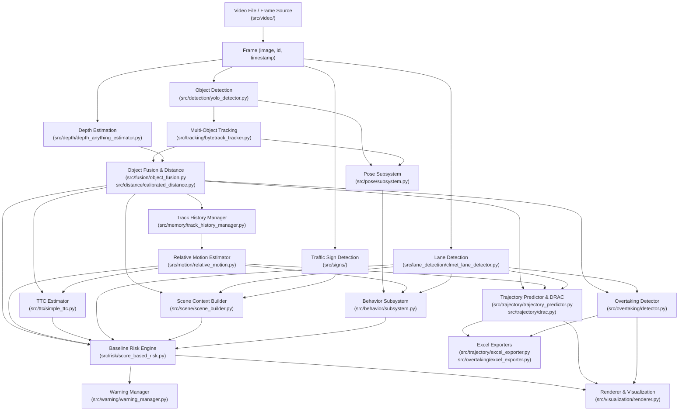
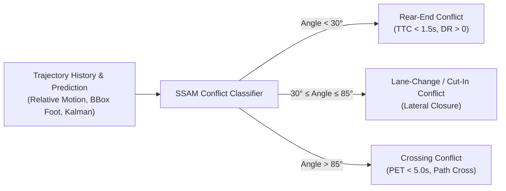
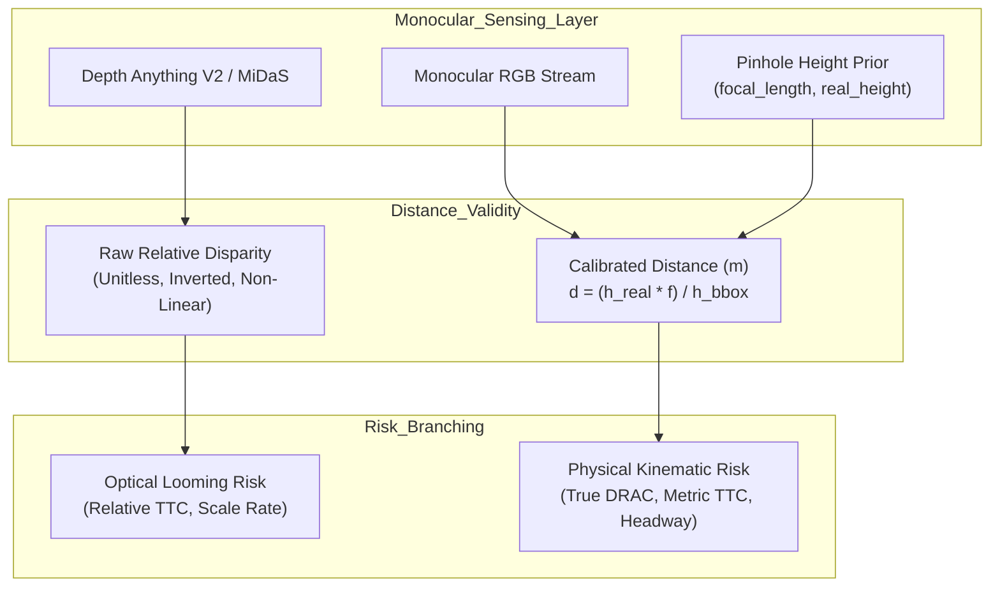
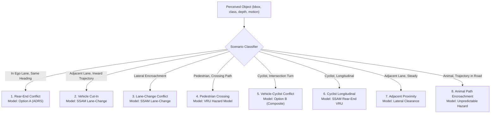
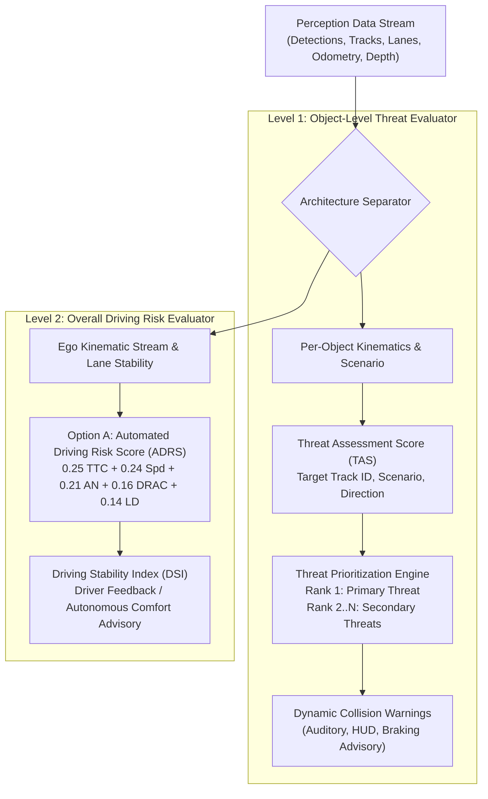
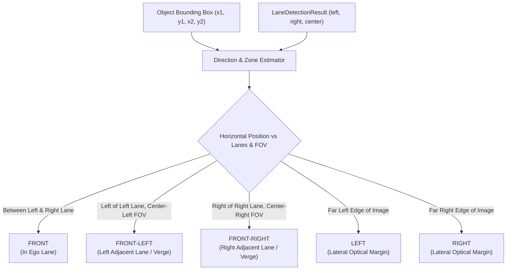
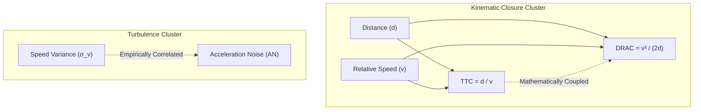
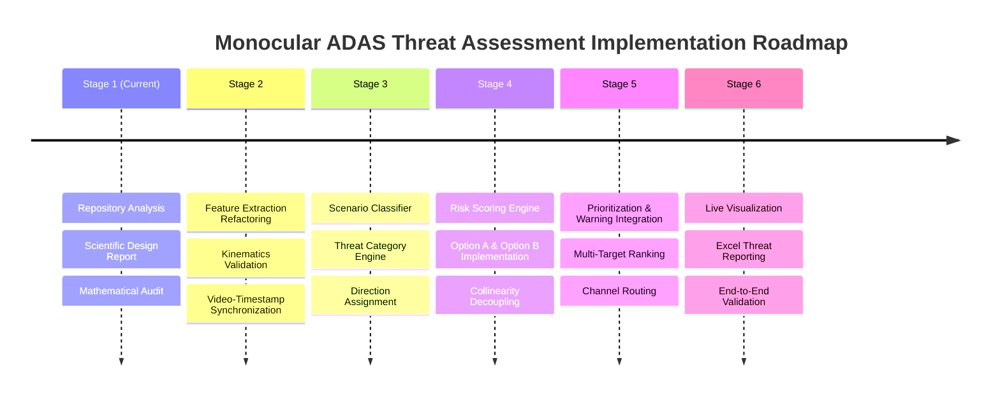

# Scientific Threat Assessment, Risk Scoring, and Threat Prioritization Architecture
## Technical Design Report for Monocular ADAS System

---

## Executive Summary

This document presents a comprehensive repository analysis and a scientifically grounded architectural design for an advanced **Threat Assessment, Risk Scoring, and Prioritization Subsystem** within the Monocular ADAS System.

The objective of this design is to transition the current baseline heuristic risk scoring engine into a modular, scenario-aware threat evaluation architecture. By leveraging published surrogate safety measures—specifically the **Integrated Automated Driving Risk Indicator (Option A, 2025)**, the **Intersection Conflict Risk Model (Option B, 2025)**, and the **FHWA Surrogate Safety Assessment Model (SSAM)**—this architecture provides rigorous risk quantification while explicitly respecting the physical, optical, and kinematic limitations of a single forward-facing monocular camera.

---

## 1. Existing Repository Exploration & Architecture Analysis

The existing codebase implements a multi-stage modular perception and driver-assistance pipeline. A thorough inspection of the repository reveals the following structure, execution sequence, and module contracts:

### Detailed Inspection of Pipeline Components

| Pipeline Component | File Path | Main Class / Function | Primary Inputs | Primary Outputs | Reusability in Threat Assessment | Technical Limitations & Constraints |
|:---|:---|:---|:---|:---|:---|:---|
| **Pipeline Orchestrator** | `src/core/pipeline.py` | `PerceptionPipeline` | `Frame` | Unified `result` dict | Direct execution host | Coordinates all perception stages; synchronous per-frame invocation. |
| **Object Detector** | `src/detection/yolo_detector.py` | `YoloDetector` | `Frame` | `list[Detection]` (`bbox`, `class_name`, `confidence`) | Directly reusable | 2D bounding boxes in image pixel coordinates; no native 3D spatial extents. |
| **Multi-Object Tracker** | `src/tracking/bytetrack_tracker.py` | `ByteTrackTracker` | `list[Detection]`, `Frame` | `list[TrackedObject]` (`track_id`, `bbox`, `class_name`) | Directly reusable | 2D Kalman-based ByteTrack; track ID switches occur during severe occlusion or exit margins. |
| **Monocular Depth** | `src/depth/depth_anything_estimator.py` | `DepthAnythingEstimator` | `Frame` | `depth_map: np.ndarray` | Reusable with calibration caveat | Uncalibrated relative inverse depth; non-linear scale across scene depth. |
| **Object Fusion & Distance** | `src/fusion/object_fusion.py` `src/distance/calibrated_distance.py` `src/distance/relative_distance.py` | `ObjectFusion` `CalibratedDistanceEstimator` `RelativeDistanceEstimator` | `list[TrackedObject]`, `depth_map`, `Frame` | `list[PerceivedObject]` (`depth`, `distance`, `depth_confidence`) | Directly reusable | Metric distance only valid when `calibrated` height-prior estimator is active; relative depth is unitless. |
| **Relative Motion** | `src/motion/relative_motion.py` | `RelativeMotionEstimator` | `TrackHistoryManager` | `dict[int, RelativeMotion]` (`speed_mps`, `acceleration_mps2`, `direction`) | Reusable with calibration caveat | Linear regression on $(t, d)$ snapshots; speed is in m/s only if distance is calibrated, otherwise relative unit/s. |
| **TTC Estimation** | `src/ttc/simple_ttc.py` | `SimpleTTCEstimator` | `list[PerceivedObject]`, `dict[int, RelativeMotion]` | `dict[int, float \| None]` | Directly reusable | Simple 1D kinematic closure assumption $TTC = d / v_{\text{close}}$; assumes constant speed; clips at $30\text{ s}$. |
| **Lane Detection** | `src/lane_detection/clrnet_lane_detector.py` | `CLRNetLaneDetector` | `Frame` | `LaneDetectionResult` (`left_lane_points`, `right_lane_points`, `confidence`) | Directly reusable | 2D image-space point curves; polynomial fits $x = ay^2 + by + c$; confidence degrades on curved or unlit roads. |
| **Scene Builder** | `src/scene/scene_builder.py` | `SceneBuilder` | `PerceivedObject`, `LaneDetectionResult`, `TrafficSign`, `Frame` | `SceneContext` (traffic light, stop/yield, nearest in-lane track) | Directly reusable | High-level operational context; latches stop/yield signs and identifies in-lane objects. |
| **Behavior Subsystem** | `src/behavior/subsystem.py` | `BehaviorSubsystem` | `PoseFrame`, `TrackHistoryManager`, `LaneDetectionResult` | `BehaviorFrame` with `BehaviorState` (`primary_label`, `crossing_probability`) | Directly reusable | Classifies pedestrian/animal road crossing, approaching, distraction, and crossing probabilities. |
| **Trajectory Predictor** | `src/trajectory/trajectory_predictor.py` | `TrajectoryPredictor` | `list[PerceivedObject]`, `RelativeMotion`, `LaneDetectionResult` | `list[TrajectoryPrediction]` (future waypoints in 2D image pixels) | Directly reusable | Predicts future image coordinates $(cx, y_2)$ using Constant Acceleration Kalman Filter (CA-KF); image-space only. |
| **DRAC Calculation** | `src/trajectory/drac.py` | `calculate_drac` | `vf_mps`, `vl_mps`, `gap_m` | `tuple[float \| None, str]` | Directly reusable | Implements $DRAC = (v_f - v_l)^2 / (2d)$; enforces strict metric sanity checks. |
| **Current Risk Engine** | `src/risk/score_based_risk.py` | `ScoreBasedRiskEngine` | `perceived`, `motion`, `ttc`, `lane`, `scene`, `behavior` | `list[RiskObject]` (`risk_score`, `risk_level`, `warning_level`) | Primary upgrade target | Uses linear heuristic ramp functions with static weights; lacks scenario classification and kinematic consistency. |
| **Warning Manager** | `src/warning/warning_manager.py` | `WarningManager` | `list[RiskObject]`, `Frame` | `list[dict]` (emitted alerts) | Directly reusable | Enforces hysteresis (3 frames) and cooldown (2.0s); currently uses `time.monotonic()` instead of video timestamps. |

---

## 2. Available Threat-Assessment Features Analysis

Every candidate risk indicator was audited against the existing codebase. The availability of each indicator is classified into four rigorous categories:

- **Available and reliable:** Directly available with sufficient physical/mathematical validity.
- **Available as a proxy:** Available, but based on image-space, relative, or uncalibrated units.
- **Derivable:** Can be directly calculated using existing pipeline mathematical structures.
- **Unavailable:** Cannot currently be calculated reliably from the monocular pipeline.

| Indicator | Intended Purpose | Availability Classification | Source Module & Field | Technical Justification & Limitations |
|:---|:---|:---|:---|:---|
| **Time to Collision (TTC)** | Predicts time until physical collision under constant closure velocity. | **Available as a proxy / Conditionally Reliable** | `src/ttc/simple_ttc.py` `SimpleTTCEstimator.estimate()` | Computed as $d / v_{\text{close}}$. When `distance.type: calibrated`, it represents physical seconds; under `distance.type: relative`, it is an optical disparity closure proxy. Clips at $30\text{ s}$. |
| **Post-Encroachment Time (PET)** | Measures temporal separation between road user A leaving and road user B entering a shared conflict zone. | **Unavailable** | None | Requires defining a shared 2D ground-plane conflict zone, recording entry/exit timestamps, and computing temporal clearance. Bounding boxes in 2D image space cannot establish spatial encroachment zones without homography or 3D world projection. |
| **Deceleration Rate to Avoid Crash (DRAC)** | Minimum constant braking deceleration required to avoid collision with lead obstacle. | **Derivable / Conditionally Reliable** | `src/trajectory/drac.py` `calculate_drac()` | Formulated as $(v_f - v_l)^2 / (2d)$. Returns valid m/s² when metric speed and distance are available; returns `UNAVAILABLE` when uncalibrated relative depth is active. |
| **Relative Speed ($v_{\text{rel}}$)** | Closing or separating rate of distance over time. | **Available as a proxy / Conditionally Reliable** | `src/motion/relative_motion.py` `RelativeMotion.speed_mps` | Estimated via linear regression over $(t, d)$ history. Metric only if distance is calibrated; represents disparity-rate if relative depth is used. |
| **Time Headway ($TH$)** | Temporal bumper-to-bumper buffer between following and leading vehicles. | **Derivable** | Derived from `obj.distance` and $v_{\text{ego}}$ | Can be computed as $TH = d / v_{\text{ego}}$. Requires ego vehicle forward speed (derivable from visual odometry, CAN telemetry, or speed limit proxy). |
| **Trajectory Conflict** | Intersection or spatial convergence of predicted future paths. | **Available as a proxy** | `src/trajectory/trajectory_predictor.py` `TrajectoryPrediction.predicted_positions` | CA-KF forecasts 2D image pixel coordinates $(cx, y_2)$ over a $2.0\text{ s}$ horizon. Evaluates image-space proximity, but 2D visual path intersection does not prove physical 3D collision. |
| **Lane Overlap / In-Lane State** | Determines whether an object occupies or encroaches upon the ego vehicle's corridor. | **Available and reliable** | `src/risk/score_based_risk.py` `_score_lane()` & `SceneContext` | Computes horizontal displacement of object base $(cx, y_2)$ relative to interpolated polynomial lane boundaries $lx(y), rx(y)$. Robustly categorizes in-lane vs adjacent objects. |
| **Lateral Deviation ($LD$)** | Offset from lane center line. | **Available and reliable** | `src/risk/score_based_risk.py` Line 150: `offset / lane_half_w` | Normalized lateral deviation: $LD = \frac{\|cx - x_{\text{center}}\|}{W_{\text{lane}} / 2}$. Directly measurable from detected lane boundaries. |
| **Speed Variation ($\sigma_v$)** | Instability or fluctuation in vehicle velocity over a temporal window. | **Derivable** | `src/memory/track_history_manager.py` | Can be computed as the sample standard deviation of estimated velocities over a sliding 1.0–2.0s observation window: $\sigma_v = \sqrt{\frac{1}{N-1}\sum (v_i - \bar{v})^2}$. |
| **Acceleration Noise ($AN$)** | Kinematic turbulence or acceleration fluctuation rate. | **Derivable** | `src/memory/track_history_manager.py` & `RelativeMotion` | Computable as the root-mean-square or standard deviation of acceleration residuals: $AN = \sqrt{\frac{1}{N}\sum a_i^2}$. Captures jerkiness in driving behavior. |
| **Right-of-Way Dominance ($ROW$)** | Priority relationships at intersections or merging conflict points. | **Available as a proxy** | `src/scene/scene_builder.py` `SceneContext` | Contextually derived from `traffic_light_state` (red/yellow/green) and latched `stop_required` / `yield_required` flags. Cannot determine fine-grained turning priority rules. |
| **Urgent Braking ($UB$)** | Rapid, high-magnitude deceleration event. | **Derivable** | `src/motion/relative_motion.py` `RelativeMotion.acceleration_mps2` | Triggered when longitudinal deceleration exceeds physical threshold (e.g., $a_{\text{rel}} < -3.5\text{ m/s}^2$) or when bounding box area expansion rate exhibits rapid optical looming ($\frac{1}{A}\frac{dA}{dt} > \theta$). |
| **Object Class** | Semantic classification of road users. | **Available and reliable** | `src/schemas/perceived_object.py` `PerceivedObject.class_name` | Direct YOLOv8 classification output (`person`, `car`, `truck`, `bus`, `motorcycle`, `bicycle`). |
| **Object Vulnerability** | Severity weighting reflecting collision vulnerability of the road user. | **Available and reliable** | Deterministic mapping from `class_name` | Vulnerable Road Users (VRUs: pedestrians, cyclists, motorcyclists) have high physical vulnerability; heavy commercial vehicles have high mass/damage potential. |

---

## 3. Scientific Basis: Published Risk-Assessment Models

### Option A — Integrated Automated Driving Risk Indicator in Urban Mixed Traffic Environments (2025)

#### Published Formulation and AHP Weights
The Automated Driving Risk Score (ADRS) was formulated using the Analytic Hierarchy Process (AHP) to evaluate driving stability and traffic conflict risk in mixed urban traffic:

$$\mathbf{ADRS} = 0.25 \times \text{TTC}_N + 0.24 \times \text{Spd}_N + 0.21 \times \text{AN}_N + 0.16 \times \text{DRAC}_N + 0.14 \times \text{LD}_N$$

Where all components are normalized variables in $[0, 1]$:
- $\text{TTC}_N$: Normalized Time to Collision (inverted: lower TTC yields higher risk).
- $\text{Spd}_N$: Normalized Standard Deviation of Speed ($\sigma_v$, capturing speed fluctuations).
- $\text{AN}_N$: Normalized Acceleration Noise (capturing acceleration turbulence/jerkiness).
- $\text{DRAC}_N$: Normalized Deceleration Rate to Avoid a Crash.
- $\text{LD}_N$: Normalized Lateral Deviation (offset relative to lane center).

#### Scientific Scope & Limitations Analysis
1. **Macro/Meso Scope vs. Per-Object Warning:**
   - Option A was developed primarily as an **integrated driving-behavior risk index** evaluating an automated vehicle's stability within a mixed traffic stream.
   - Speed variation ($\sigma_v$) and acceleration noise ($AN$) are classic traffic-flow turbulence indicators (pioneered by Herman et al., 1959; Treiterer, 1975). They evaluate whether a vehicle is driving erratically or experiencing unstable stop-and-go flow.
   - **Critical Architectural Distinction:** Option A is highly appropriate for **Overall Driving Risk Assessment** and **Car-Following / Rear-End Threat Evaluation** of a lead vehicle. However, it cannot be applied meaningfully to crossing pedestrians or cyclists, who do not possess a defined "lane lateral deviation" ($LD_N$) or car-following DRAC.
2. **Measurement Requirements & Normalization Procedure:**
   - The original paper specifies normalization to $[0, 1]$ using empirical operational boundaries. In our monocular system:
     $$\text{TTC}_N = \max\left(0, 1 - \frac{\text{TTC}}{\text{TTC}_{\text{safe}}}\right), \quad \text{with } \text{TTC}_{\text{safe}} = 6.0\text{ s}, \; \text{TTC}_{\text{crit}} = 1.0\text{ s}$$
     $$\text{DRAC}_N = \min\left(1, \frac{\text{DRAC}}{\text{DRAC}_{\text{max}}}\right), \quad \text{with } \text{DRAC}_{\text{max}} = 5.0\text{ m/s}^2$$
     $$\text{LD}_N = \min\left(1, \frac{|x_{\text{obj}} - x_{\text{lane\_center}}|}{W_{\text{lane}} / 2}\right)$$
     $$\text{Spd}_N = \min\left(1, \frac{\sigma_v}{\sigma_{v,\text{max}}}\right), \quad \text{with } \sigma_{v,\text{max}} = 3.0\text{ m/s}$$
     $$\text{AN}_N = \min\left(1, \frac{\sigma_a}{\sigma_{a,\text{max}}}\right), \quad \text{with } \sigma_{a,\text{max}} = 2.0\text{ m/s}^2$$
3. **Application Rule:**
   - The published weights $(0.25, 0.24, 0.21, 0.16, 0.14)$ are preserved **exactly as published** and allocated to the **Rear-End / Car-Following Scenario** and the **Overall Driving Risk Engine**.

---

### Option B — Temporal Margins and Behavioral Features for Early Risk Assessment in Left-Turn Vehicle and Bicycle Conflicts at Signalized Intersections (2025)

#### Published Formulation and Composite Weights
Developed specifically for signalized intersection conflict zones involving turning motor vehicles and crossing bicycles:

$$\mathbf{CR} = 0.30 \times \text{PET}_N + 0.30 \times \text{TTC}_N + 0.20 \times V_{\text{comb}, N} + 0.10 \times \text{DRAC}_N + 0.05 \times \text{ROW}_N + 0.05 \times \text{UB}_N$$

Where:
- $\text{PET}_N$: Normalized Post-Encroachment Time.
- $\text{TTC}_N$: Normalized Time to Collision.
- $V_{\text{comb}, N}$: Combined conflict velocity of turning vehicle and bicycle.
- $\text{DRAC}_N$: Deceleration Rate to Avoid Crash.
- $\text{ROW}_N$: Right-of-Way dominance indicator ($1$ if crossing cyclist has green/priority, $0$ otherwise).
- $\text{UB}_N$: Urgent-braking flag ($1$ if emergency braking is detected, $0$ otherwise).

#### Scientific Scope & Limitations Analysis
1. **Severe Scenario Specificity:**
   - Option B was derived from empirical trajectory observations of **left-turning motor vehicles conflicting with straight-crossing bicycles** at signalized urban junctions.
   - It assumes the existence of an intersection conflict area with observable entering and exiting trajectories.
   - **Critical Architectural Restriction:** Option B must **never be applied indiscriminately** to highway car-following, rear-end tracking, or rural driving. It is applicable specifically to **Vehicle–Cyclist Crossing Conflicts** and **Intersection Turning Scenarios**.
2. **The PET Limitation in Monocular Vision:**
   - Post-Encroachment Time ($PET$) accounts for $30\%$ of Option B's composite weight.
   - In a single forward-facing monocular camera without roadside infrastructure or road-surface bird's-eye-view (BEV) mapping, true PET cannot be calculated because the physical boundary of the conflict polygon cannot be established.
   - **Handling Strategy:** The system must not fabricate pseudo-PET values from image pixel distances. When PET is physically unavailable, Option B cannot be evaluated in its pure published form without an explicit proxy clearance mechanism. When applied to intersection cyclist crossing, if PET is unobserved, the architecture logs `PET_UNAVAILABLE` rather than arbitrarily redistributing weights.
3. **Application Rule:**
   - The published weights $(0.30, 0.30, 0.20, 0.10, 0.05, 0.05)$ are preserved **strictly** for intersection crossing conflicts involving cyclists and pedestrians.

---

## 4. FHWA SSAM: Supporting Conflict Indicators

The Federal Highway Administration (FHWA) Surrogate Safety Assessment Model (SSAM) is the recognized standard for non-crash safety surrogate evaluation. In this architecture, SSAM serves as the **scientific validation and conflict-classification reference**, rather than a source of arbitrary ad-hoc warning coefficients.

### SSAM Indicator Definitions & System Compatibility

| SSAM Indicator | Standard Definition | Availability in Monocular Pipeline | Role in Threat Assessment Subsystem |
|:---|:---|:---|:---|
| **TTC** | Minimum time-to-collision between two conflict entities. | Available (Metric or Proxy) | Threshold gating: conflicts with $TTC < 1.5\text{ s}$ trigger critical collision alerts. |
| **PET** | Time between first entity departure and second entity arrival at conflict point. | Unavailable (requires conflict polygon) | Benchmark metric for post-hoc validation; proxy approximations evaluated in intersection scenarios. |
| **MaxS** | Maximum speed observed by either conflict vehicle during interaction. | Available via motion estimator | Contextual severity multiplier: higher approach speed amplifies conflict severity. |
| **DeltaS ($\Delta S$)** | Difference in vehicle speeds at the point of minimum TTC. | Available via `RelativeMotion` | Measures closing speed severity; critical for distinguishing stationary obstacles from moving leads. |
| **DR (Initial Deceleration)** | Initial deceleration required by following vehicle to avoid conflict. | Directly equivalent to `DRAC` | Evaluates urgency of driver avoidance response; threshold $DR > 3.4\text{ m/s}^2$ indicates emergency braking. |
| **MaxD (Peak Deceleration)** | Maximum deceleration rate exhibited during conflict event. | Derivable from track history | Validates whether urgent avoidance manoeuvre took place. |
| **Conflict Angle ($\theta$)** | Convergence angle of vehicle velocity vectors at conflict point. | Derivable via Kalman heading vectors | Classified according to FHWA rules: **Rear-End** ($|\theta| < 30^\circ$), **Lane-Change** ($30^\circ \le |\theta| \le 85^\circ$), **Crossing** ($|\theta| > 85^\circ$). |

---

## 5. Measurement Validity and Physical Limitations of Monocular Vision

A core mandate of this architecture is **physical honesty**: the system must never present uncalibrated optical quantities as true physical measurements.

### A. Monocular Depth: Relative Disparity vs. Metric Distance
- **Relative Depth (Default):** Output by Depth Anything V2 / MiDaS. It represents inverse disparity values with non-linear scaling across the field of view. It **must not** be treated as metric meters. Metric closing speed and metric DRAC cannot be derived from it.
- **Calibrated Distance:** When `distance.type: calibrated` is active, distance is computed via the pinhole camera geometry:
  $$d_{\text{metric}} = \frac{h_{\text{real}} \times f_x}{h_{\text{bbox}}}$$
  This is valid only if object class priors ($h_{\text{real}}$) match physical reality and the vehicle is unoccluded vertically. Partial vertical occlusion (e.g. car behind crest or guardrail) artificially shrinks $h_{\text{bbox}}$, causing distance to be overestimated.

### B. Time to Collision (TTC) Reliability
- `SimpleTTCEstimator` assumes 1D head-on linear closure: $TTC = d / v_{\text{close}}$.
- When both $d$ and $v_{\text{close}}$ are metric, TTC is physically valid.
- Under relative depth, $TTC_{\text{proxy}} = d_{\text{rel}} / \dot{d}_{\text{rel}}$ provides an **optical expansion proxy** (related to time-to-contact via tau-theory: $\tau = \theta / \dot{\theta}$). It is reliable for ranking urgency, but cannot be treated as wall-clock seconds.

### C. Post-Encroachment Time (PET) Limitations
- PET strictly requires establishing the physical entry timestamp $t_{\text{in}}$ and exit timestamp $t_{\text{out}}$ of a localized road-surface patch.
- Monocular cameras suffer from scale ambiguity and lack ground-plane depth registration without planar homography. Consequently, PET is classified as **UNAVAILABLE** in generic road segments.

### D. Deceleration Rate to Avoid Crash (DRAC) Validity
- $DRAC = \frac{(v_f - v_l)^2}{2d}$ has physical dimensions of $\text{m/s}^2$.
- If $d$ is in relative units, dimensional consistency is violated, rendering the calculation invalid. The `calculate_drac` module correctly returns `UNAVAILABLE` unless metric units are explicitly enabled and verified.

### E. Trajectory Conflict in Image Space
- Trajectories predicted by CA-KF operate in 2D image coordinates $(cx, y_2)$.
- **Optical Illusion Risk:** An object moving horizontally across the upper image plane may visually intersect with a closer object's vertical bounding box without physical collision in 3D.
- **Handling:** Trajectory conflicts must be gated by relative depth consistency and lane corridor boundaries before declaring a collision trajectory.

### F. Time Synchronization Integrity
- System audit revealed that while `Frame.timestamp` provides monotonic video seconds, `WarningManager` was using `time.monotonic()` for alert cooldowns.
- **Architectural Requirement:** All threat calculations, history windows, kinematics, and alert cooldowns must be synchronized strictly to **video presentation timestamps (`frame.timestamp`)**. Wall-clock system time must be eliminated from all risk decision logic.

---

## 6. Scenario-Specific Threat Categories

Rather than applying a single monolithic risk equation to all detected objects, the architecture classifies each road user into a distinct **Interaction Scenario**. Each scenario activates only its validated risk indicators.

### Scenario Specification Matrix

| Scenario Type | Triggering Conditions & Required Inputs | Active Risk Indicators | Applicable Model | Unavailable / Excluded Indicators | Primary Failure Modes & Sensor Limitations | Warning Reliability |
|:---|:---|:---|:---|:---|:---|:---|
| **1. Rear-End Conflict** | In-lane vehicle ahead; bounding box between lane curves; closing speed $> 0$. | TTC, DRAC, $\Delta S$, Headway, Lateral Deviation | **Option A (ADRS)** | PET (no crossing conflict) | Vertical occlusion overestimates distance; abrupt lead vehicle deceleration requires 3-frame filtering. | **High** (when metric calibrated); **Moderate** (when relative depth proxy). |
| **2. Vehicle Cut-In** | Vehicle in adjacent lane; lateral velocity toward ego lane; predicted path crosses lane boundary. | Lateral approach velocity, TTC, Lane boundary distance, Looming rate | **SSAM Lane-Change Conflict** | Option B (no signalized cyclist interaction) | Missing lane markings; false alarm on gentle curves where vehicle appears to cross straight projection. | **High** (with active lane tracking); **Moderate** (geometric fallback). |
| **3. Lane-Change Conflict** | Ego vehicle initiating lane change toward occupied lane (or adjacent vehicle encroaching). | Lateral closure rate, Longitudinal gap, Blind-spot proximity | **SSAM Lane-Change Conflict** | Option A (not a car-following scenario) | Camera FOV cut-off: vehicle alongside front fender disappears from camera view before pass completes. | **Moderate** (forward FOV only; cannot verify rear flank). |
| **4. Pedestrian Crossing** | Class: `person`; detected near/in road; `crossing_probability` $> 0.3$; lateral trajectory toward corridor. | Crossing probability, TTC, Visual distance, Distraction/Fallen label | **VRU Crossing Hazard Architecture** | Option A (pedestrian has no lane-center lateral deviation) | Keypoint occlusion in heavy clothing; small bounding box at distances $> 35\text{ m}$. | **High** (combining pose, trajectory, and lane context). |
| **5. Vehicle–Cyclist Conflict** | Class: `bicycle`; intersection scene context; turning or crossing trajectory alignment. | TTC, Combined velocity, Right-of-Way dominance, Urgent braking | **Option B (Composite Risk)** | PET (excluded unless planar homography is available) | Cyclist speed estimation noisy from bounding box wobble; pedal motion causes bounding box height oscillation. | **Moderate** (high contextual dependence on signal state). |
| **6. Cyclist Longitudinal** | Class: `bicycle`; in ego corridor or edge; longitudinal travel. | TTC, Distance headway, Relative closing speed | **VRU Longitudinal Buffer** | Option B (not an intersection conflict) | Cyclist speed varies rapidly due to grade/pedaling; narrow profile challenges optical depth estimation. | **High** (high vulnerability weighting). |
| **7. Adjacent-Lane Proximity** | Vehicle in adjacent lane traveling parallel; no inward lateral velocity. | Lateral distance, Longitudinal alignment, Relative velocity | **Lateral Clearance Buffer** | Option A & Option B (non-conflict scenario) | Wide vehicles (buses/trucks) visually encroach across lane boundary without physical hazard. | **High** (suppresses spurious collision alarms). |
| **8. Animal Encroaching** | Class: `animal`; behavior label `crossing_road` or `approaching_road`. | Crossing probability, Distance, Looming rate, Motion heading | **Unpredictable Hazard Engine** | Option A & Option B (non-vehicular dynamics) | Low pose confidence for quadruped species; erratic velocity changes; nocturnal visibility limitations. | **Moderate** (early advisory warning preferred over emergency braking). |

---

## 7. Object-Level Threat Assessment vs. Overall Driving Risk

A critical architectural flaw in naive ADAS systems is combining macro driving conditions and micro collision threats into a single conflated score. This architecture strictly separates them into two parallel evaluators:

### Architectural Separation Rules
1. **Level 1 — Object-Level Threat Assessment (TAS):**
   - Evaluates **discrete, localized collision hazards** between the ego vehicle and an individual tracked road user.
   - Outputs: Primary threat track ID, scenario classification, camera-relative direction, time-to-impact, and warning urgency.
   - **Does NOT** incorporate ego-vehicle acceleration noise or ego speed variation into the object's score.
2. **Level 2 — Overall Driving Risk Assessment (ADRS - Option A):**
   - Evaluates **overall operational turbulence and driving smoothness** over a temporal window ($5\text{–}10\text{ s}$).
   - Integrates ego acceleration noise ($AN$), speed variation ($\sigma_v$), lane keeping lateral deviation ($LD$), and ambient traffic TTC/DRAC distributions.
   - Outputs: Driving Stability Index (DSI) displayed on the secondary HUD or used by automated driving planners to smooth out throttle/steering.
3. **Prohibition of Cross-Contamination:**
   - Under no circumstances is the macro ADRS score added to an individual object's threat score. A steady, smooth driver encountering a sudden jaywalking pedestrian must trigger an immediate CRITICAL object warning even if the macro driving score was perfectly calm.

---

## 8. Camera-Relative Direction Estimation Architecture

A forward-facing monocular camera has an optical field of view defined by its horizontal angle $\alpha_{\text{FOV}}$ (typically $60^\circ\text{–}90^\circ$). Directions assigned to threats must be strictly **camera-relative**:

### Direction Mapping Specifications

| Camera-Relative Direction | Optical & Geometric Criteria | Functional ADAS Meaning | Physical Limitations |
|:---|:---|:---|:---|
| **`FRONT`** | Bounding box foot center $cx \in [lx(by), rx(by)]$. | Object directly in the ego travel corridor. | Primary collision zone. |
| **`FRONT_LEFT`** | $cx < lx(by)$ and $cx > 0.15 \times W_{\text{image}}$. | Object in left adjacent lane, sidewalk, or crossing from the left. | Threat zone for cut-ins, left-side pedestrian crossings, or oncoming traffic. |
| **`FRONT_RIGHT`** | $cx > rx(by)$ and $cx < 0.85 \times W_{\text{image}}$. | Object in right adjacent lane, verge, or entering from the right. | Threat zone for cut-ins, right-side pedestrian crossings, or parked vehicle egress. |
| **`LEFT`** | $cx \le 0.15 \times W_{\text{image}}$ and $by > 0.50 \times H_{\text{image}}$. | Object alongside vehicle in left lateral margin. | Passing/overtaken vehicle; rapidly leaving camera field of view. |
| **`RIGHT`** | $cx \ge 0.85 \times W_{\text{image}}$ and $by > 0.50 \times H_{\text{image}}$. | Object alongside vehicle in right lateral margin. | Passing/overtaken vehicle; rapidly leaving camera field of view. |

### Strict Operational Boundaries
- **No Rear/Blind-Spot Coverage:** The forward monocular camera has **zero visibility** into rear-left, rear-right, or direct rear zones. The system must explicitly document that **Blind Spot Monitoring (BSM) and Rear Cross-Traffic Alert (RCTA) are physically unsupported**.
- **Curve Compensation:** On curved roads, straight image-coordinate vertical strips fail. The direction estimation must use polynomial lane boundary interpolation $lx(by), rx(by)$ rather than fixed image-center splits.

---

## 9. Proposed Modular Threat Assessment Architecture

The proposed Threat Assessment Subsystem comprises nine modular, pipelined stages executed synchronously on each frame:

```mermaid
graph TD
    subgraph Stage_1["Stage 1: Perception Data Ingestion"]
        S1_Data["Detections, Tracks, Depth Map, Distance,<br/>Relative Motion, Lanes, Scene Context, Behavior, Trajectories"]
    end

    subgraph Stage_2["Stage 2: Feature & Kinematic Extraction"]
        S2_Feat["Compute Closing Velocity, Headway, Acceleration,<br/>Lane Lateral Offset, Looming Rate, Crossing Probability"]
    end

    subgraph Stage_3["Stage 3: Scenario Classification Engine"]
        S3_Class["Classify into 1 of 8 Scenarios<br/>(Rear-End, Cut-In, Pedestrian, Cyclist, Animal, Proximity)"]
    end

    subgraph Stage_4["Stage 4: Sensor & Indicator Validity Assessment"]
        S4_Valid["Audit Distance Validity (Metric vs Relative),<br/>TTC Finiteness, Lane Confidence, Pose Confidence"]
    end

    subgraph Stage_5["Stage 5: Scenario Risk Model Selection"]
        S5_Model["Select Model:<br/>Option A (Rear-End/Driving Stability)<br/>Option B (Intersection Cyclist)<br/>SSAM (Cut-In/Lane-Change)<br/>VRU Engine (Pedestrian/Animal)"]
    end

    subgraph Stage_6["Stage 6: Risk Scoring & Quantification"]
        S6_Score["Evaluate Normalized Equations without Collinearity<br/>Compute Raw Threat Assessment Score (TAS ∈ [0, 100])"]
    end

    subgraph Stage_7["Stage 7: Threat Prioritization Engine"]
        S7_Rank["Rank all Active Targets by TAS<br/>Assign Primary Threat (Rank 1) & Secondary Threats"]
    end

    subgraph Stage_8["Stage 8: Direction & Zone Assignment"]
        S8_Dir["Assign Camera-Relative Vector:<br/>FRONT, FRONT_LEFT, FRONT_RIGHT, LEFT, RIGHT"]
    end

    subgraph Stage_9["Stage 9: Dynamic Warning & Alert Generation"]
        S9_Alert["Apply Hysteresis & Cooldown (Video Timestamps)<br/>Dispatch Auditory/Visual Alerts via WarningManager"]
    end

    S1_Data --> S2_Feat --> S3_Class --> S4_Valid --> S5_Model --> S6_Score --> S7_Rank --> S8_Dir --> S9_Alert
```

### Detailed Specifications for Conceptual Stages

1. **Stage 1: Perception Data Ingestion:**
   - Consumes standardized pipeline data structures: `PerceivedObject`, `RelativeMotion`, `LaneDetectionResult`, `SceneContext`, `BehaviorFrame`, `TrajectoryPrediction`.
2. **Stage 2: Feature & Kinematic Extraction:**
   - Extracts time-series kinematics: lateral offset $LD$, closing rate $\Delta S$, acceleration noise $AN$, speed variance $\sigma_v$, looming rate $\frac{1}{A}\frac{dA}{dt}$.
3. **Stage 3: Scenario Classification Engine:**
   - Evaluates object class, lane geometry relation, and velocity heading vector to map the track into one of the 8 canonical scenarios.
4. **Stage 4: Sensor & Indicator Validity Assessment:**
   - Checks validity flags: Is distance metric or relative? Is lane confidence $> 0.2$? Is tracking continuous or recovering from grace period? Flags degraded indicators.
5. **Stage 5: Scenario-Specific Risk Model Selection:**
   - Directs the object to its appropriate risk formulation (Option A for rear-end; Option B for intersection cyclist; SSAM rules for cut-ins; VRU hazard for pedestrians).
6. **Stage 6: Risk Scoring & Quantification:**
   - Computes normalized mathematical threat score $\text{TAS} \in [0, 100]$. Never combines incompatible models.
7. **Stage 7: Threat Prioritization Engine:**
   - In dense urban scenes with multiple road users, sorts active targets:
     $$\text{Priority Rank} = \operatorname{argsort}(\text{TAS}_{\text{obj}})$$
     Isolates the single **Primary Threat** requiring immediate driver intervention, while maintaining a secondary threat queue.
8. **Stage 8: Direction & Zone Assignment:**
   - Tags each prioritized threat with its camera-relative sector (`FRONT`, `FRONT_LEFT`, `FRONT_RIGHT`, `LEFT`, `RIGHT`).
9. **Stage 9: Dynamic Warning & Alert Generation:**
   - Feeds prioritized threats into `WarningManager`, applying temporal hysteresis ($3\text{ frames}$) and cooldown ($2.0\text{ s}$ synced to `frame.timestamp`).

---

## 10. Collinearity, Correlation & Avoiding Double-Counting

A critical scientific pitfall in composite risk scoring is **collinearity**—combining mathematically coupled indicators in an additive linear sum, which inadvertently squares or cubes underlying variables.

### Mathematical Coupling & Collinearity Matrix

| Paired Indicators | Mathematical Relationship | Correlation Nature | Risk of Blind Addition | Architectural Remedy |
|:---|:---|:---|:---|:---|
| **TTC vs. Relative Speed** | $TTC = d / v_{\text{rel}}$ | Strong inverse dependency | Over-penalizes high closing speed when distance is already small. | Use TTC as primary temporal envelope; use speed only as a scaling threshold or severity gate. |
| **TTC vs. DRAC** | $DRAC = \frac{v_{\text{rel}}}{2 \times TTC}$ | Direct algebraic coupling | Adding TTC and DRAC doubles the weight of closing velocity relative to distance. | In Option A, preserve published weights strictly; in custom VRU scenarios, do not sum both additively without orthogonalization. |
| **Trajectory Conflict vs. Lane Overlap** | Predicted image path $y_2$ aligns with lane boundaries | Spatial collinearity | An object in the lane ahead already has high lane overlap; adding trajectory overlap counts the same geometry twice. | Use lane overlap as static spatial filter; use trajectory prediction specifically for dynamic boundary crossing (cut-in/crossing). |
| **Speed Variation ($\sigma_v$) vs. Acceleration Noise ($AN$)** | $a = \frac{dv}{dt}$, so $\sigma_a \propto \omega \sigma_v$ | Dynamic physical derivative coupling | Both measure driver throttle turbulence; simultaneous inclusion inflates driving roughness weight. | Preserve in Option A macro assessment per published AHP formulation; avoid in per-object warning scores. |

---

## 11. Missing Capabilities & Technical Limitations

1. **Planar Homography / Bird's-Eye-View (BEV) Absence:**
   - Without extrinsic calibration (pitch/roll camera angles, mounting height) and inverse perspective mapping (IPM), road-plane metric coordinate transformation is unavailable.
2. **True PET Unavailability:**
   - Post-encroachment time cannot be established without road-surface conflict polygon tracking.
3. **Monocular Occlusion Fragility:**
   - Distance calculation based on vertical height priors fails during partial vertical occlusion (e.g. car emerging from behind a wall or barrier).
4. **Field of View Blind Spots:**
   - Lateral passes alongside ego doors and rear flanks are invisible to the front camera.
5. **Night / Inclement Weather Degradation:**
   - Visual lane detection (CLRNet) and monocular depth nets experience confidence drops in low illumination, rain, or glare.

---

## 12. Recommended Implementation Sequence (Remaining 5 Stages)

To execute the threat assessment implementation cleanly without regressions, the following step-by-step roadmap is recommended:

1. **Stage 1 (Current):** Complete repository analysis, scientific model audit, and architectural design report.
2. **Stage 2 — Feature & Kinematic Foundation:**
   - Refactor feature extraction to ensure strict synchronization with `frame.timestamp`.
   - Implement metric/relative indicator validity tagging.
3. **Stage 3 — Scenario Classification & Direction Estimation:**
   - Implement the 8-scenario classifier.
   - Implement camera-relative sector assignment (`FRONT`, `FRONT_LEFT`, `FRONT_RIGHT`, `LEFT`, `RIGHT`).
4. **Stage 4 — Scenario-Specific Risk Scoring:**
   - Implement Option A (ADRS) for car-following and overall driving risk.
   - Implement Option B for signalized intersection cyclist conflicts.
   - Implement SSAM-based cut-in and VRU hazard evaluators.
5. **Stage 5 — Prioritization & Warning Dispatch:**
   - Implement multi-target threat ranking ($\text{Rank 1}$ Primary Threat).
   - Integrate with `WarningManager` using video timestamp cooldowns.
6. **Stage 6 — Visualization, Reporting & Validation:**
   - Implement independent threat HUD overlay layer.
   - Implement comprehensive Excel reporting for threat diagnostics.
   - Execute performance benchmarking and validation on test videos.

---

## 13. Open Questions Requiring Approval Before Implementation

Before proceeding to code implementation in Stage 2, the following technical and architectural decisions require formal user confirmation:

1. **Option A Scope Confirmation:**
   - *Question:* Should Option A (ADRS) be deployed primarily as an **Overall Driving Stability Evaluator** (monitoring driving smoothness and lead vehicle following), or do you want it forced as a per-object score on all motorized vehicles?
   - *Recommendation:* Deploy Option A for Overall Driving Risk and Lead Vehicle Car-Following, while using SSAM and VRU hazard logic for cut-ins and crossing pedestrians/cyclists.
2. **Option B PET Proxy Approval:**
   - *Question:* Since true physical Post-Encroachment Time (PET) cannot be computed without BEV homography, should Option B in intersection vehicle-cyclist conflicts use an optical clearance time proxy, or should it log `PET_UNAVAILABLE` and evaluate the remaining published factors?
   - *Recommendation:* Log `PET_UNAVAILABLE` and compute normalized risk using the remaining observable factors, avoiding fabricated values.
3. **Distance Mode Default:**
   - *Question:* Should the system enforce `distance.type: calibrated` as a prerequisite for metric DRAC and metric TTC calculations, with an automatic fallback to optical proxy mode when relative depth is active?
   - *Recommendation:* Yes. This enforces physical honesty and prevents uncalibrated depth from corrupting metric formulas.
4. **Warning Threshold Finalization Strategy:**
   - *Question:* Do you approve deferring numerical LOW, MEDIUM, and HIGH alert thresholds until Stage 4 (after kinematic indicators are empirically measured on validation videos), rather than hardcoding arbitrary thresholds upfront?
   - *Recommendation:* Defer threshold calibration to Stage 4 to ensure empirical stability.

---

*Report authored for Monocular ADAS Architecture Documentation.*

