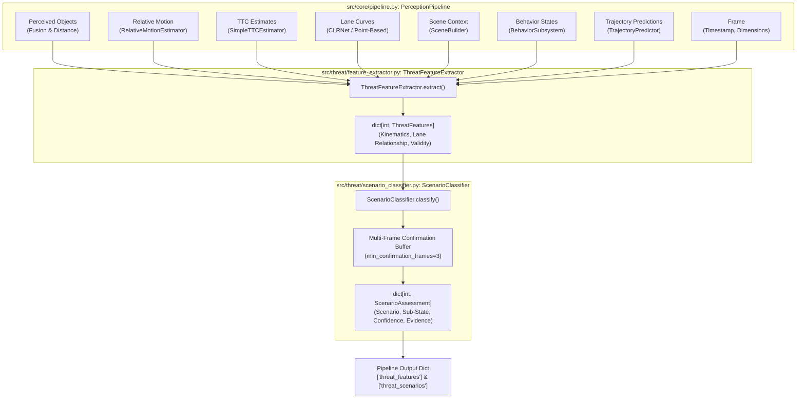

# Threat Feature Extraction and Scenario Classification
## Technical Specification and Implementation Guide

---

## Executive Overview

This document specifies the **Threat Feature Extraction and Scenario Classification** subsystem implemented in Stage 2 of the Priority-Based Warning System for the Monocular ADAS System.

The subsystem extracts individual kinematic, spatial, behavioral, and conflict indicators for every tracked road user and classifies its interaction with the ego vehicle into discrete, traffic-conflict scenarios. Every indicator carries explicit physical validity metadata, maintaining rigorous physical honesty by preventing the silent conversion of unavailable or proxy values into zeroes or metric units.

---

## 1. Subsystem Architecture

The threat feature extraction and scenario classification components reside in `src/threat/` and integrate into the main perception pipeline immediately following trajectory prediction and overtaking detection:



---

## 2. Extracted Risk Indicators and Validity Mapping

Every extracted indicator carries an explicit `IndicatorValidity` record with a `ValidityStatus` enum (`VALID_METRIC`, `VALID_PROXY`, `UNCERTAIN`, `UNAVAILABLE`) and diagnostic explanation:

| Indicator Name | Mathematical Definition | Source Pipeline Module | Measurement Type | Validity Status | Conditions & Physical Constraints |
|:---|:---|:---|:---|:---|:---|
| **`ttc`** | $d / v_{\text{close}}$ | `src/ttc/simple_ttc.py` | Temporal (seconds) | `VALID_METRIC` / `VALID_PROXY` / `UNAVAILABLE` | `VALID_METRIC` if `distance.type: calibrated` and closing speed $> 0$; `VALID_PROXY` under relative depth (disparity closure); `UNAVAILABLE` if receding or non-closing. |
| **`pet`** | $t_{\text{in}, 2} - t_{\text{out}, 1}$ | N/A | Temporal (seconds) | `UNAVAILABLE` | Always marked `UNAVAILABLE` in forward monocular camera because ground-plane conflict polygon tracking requires planar homography or BEV. |
| **`drac`** | $\frac{(v_f - v_l)^2}{2d}$ | `src/trajectory/drac.py` | Acceleration ($\text{m/s}^2$) | `VALID_METRIC` / `UNAVAILABLE` | `VALID_METRIC` only if `distance.type: calibrated` and $v_f > v_l$; returns $0.0$ if $v_f \le v_l$; `UNAVAILABLE` under relative uncalibrated depth. |
| **`relative_motion`** | $\Delta d / \Delta t$ | `src/motion/relative_motion.py` | Velocity / Accel | `VALID_METRIC` / `VALID_PROXY` / `UNAVAILABLE` | `VALID_METRIC` if calibrated; `VALID_PROXY` if relative depth regression; `UNAVAILABLE` if $< 3$ track snapshots. |
| **`speed_variation`** | $\sigma_v = \sqrt{\frac{1}{N-1}\sum (v_i - \bar{v})^2}$ | `ThreatFeatureExtractor` | Velocity variance | `VALID_METRIC` / `VALID_PROXY` | Evaluated over sliding temporal window ($1.5\text{ s}$). Metric if calibrated; proxy if uncalibrated. |
| **`acceleration_noise`** | $AN = \sqrt{\frac{1}{N}\sum a_i^2}$ | `ThreatFeatureExtractor` | Acceleration RMS | `VALID_METRIC` / `VALID_PROXY` | Evaluated over sliding window ($1.5\text{ s}$) from consecutive acceleration estimates. |
| **`looming_rate`** | $\frac{1}{A}\frac{dA}{dt}$ | `ThreatFeatureExtractor` | Optical expansion ($1/\text{s}$) | `VALID_PROXY` | Normalized optical bounding box area growth rate over $\Delta t \ge 0.1\text{ s}$. |
| **`lane_overlap`** | $\frac{W_{\text{overlap}}}{W_{\text{bbox}}}$ | `ThreatFeatureExtractor` & `LaneDetectionResult` | Spatial ratio $[0, 1]$ | `VALID_METRIC` / `VALID_PROXY` / `UNAVAILABLE` | Fraction of horizontal bounding box footprint spanning polynomial/point lane boundaries $lx(y), rx(y)$. `UNAVAILABLE` if lane confidence $< 0.1$. |
| **`lateral_deviation`** | $\frac{\|cx - x_{\text{center}}\|}{W_{\text{lane}} / 2}$ | `ThreatFeatureExtractor` | Dimensionless ratio | `VALID_METRIC` / `VALID_PROXY` / `UNAVAILABLE` | Normalized distance from lane centerline. $< 1.0$ is inside lane; $> 1.0$ is outside lane. |
| **`trajectory_conflict`** | CA-KF image corridor intersection | `src/trajectory/trajectory_predictor.py` | State enum & seconds | `VALID_PROXY` / `UNCERTAIN` / `UNAVAILABLE` | `CONFLICT` if predicted future waypoints cross into ego travel corridor; `NO_CONFLICT` if trajectory diverges; `UNCERTAIN` if $< 3$ waypoints. |
| **`crossing_probability`** | Pose / lateral motion heuristic | `src/behavior/subsystem.py` | Probability $[0, 1]$ | `VALID_PROXY` / `UNAVAILABLE` | Available for pedestrians and animals from pose keypoint kinematics and lateral trajectory heading. |

---

## 3. Camera-Relative Spatial Direction Mapping

Direction estimation is strictly **camera-relative** ($60^\circ\text{–}90^\circ$ optical FOV):

```
+-------------------------------------------------------------------------+
|                                                                         |
|   LEFT        FRONT_LEFT          FRONT          FRONT_RIGHT     RIGHT  |
| (Periphery)  (Left Lane/Verge)  (Ego Lane)      (Right Lane/Verge)(Periphery)|
|  cx <= 0.15W     cx < lx        lx <= cx <= rx      cx > rx      cx >= 0.85W|
|  by > 0.50H                                                      by > 0.50H |
+-------------------------------------------------------------------------+
```

> [!IMPORTANT]
> **No Rear or Blind-Spot Coverage:** The forward monocular camera has zero visibility into rear or rear-side zones. Blind-Spot Monitoring (BSM) and Rear Cross-Traffic Alert (RCTA) are physically unsupported.

---

## 4. Scenario Classification Logic and State Transitions

Interactions are classified into five primary scenarios plus supporting animal conflict categories:

### Scenario 1 — Rear-End Conflict (`REAR_END`)
- **Target:** Motorized vehicles ahead in ego travel lane (`EGO_LANE` or overlap $\ge 0.50$).
- **States:**
  - `REAR_END_CONFLICT`: Closing motion ($v_{\text{close}} > 0.3\text{ m/s}$ or looming $> 0.15$) and ($TTC \le 4.5\text{ s}$ or $DRAC \ge 2.0\text{ m/s}^2$ or trajectory conflict).
  - `REAR_END_POTENTIAL`: In-lane ahead with moderate headway ($4.5 < TTC \le 8.0\text{ s}$), neutral closing speed ($0 \le v \le 0.3\text{ m/s}$), or steady car-following.
  - `NO_REAR_END_CONFLICT`: In-lane ahead, but receding ($v_{\text{close}} < -0.3\text{ m/s}$ or motion `receding`).
  - `UNCERTAIN`: In-lane ahead, but observation history $< 3$ frames or motion unconfirmed.

### Scenario 2 — Pedestrian Crossing Conflict (`PEDESTRIAN_CROSSING`)
- **Target:** `person` / `pedestrian` road users.
- **States:**
  - `PEDESTRIAN_CROSSING_CONFLICT`: In ego lane or entering ego lane with crossing probability $\ge 0.35$, trajectory path intersection, or behavior label `human_crossing_road`.
  - `PEDESTRIAN_APPROACHING_PATH`: Outside ego lane (verge/adjacent lane) moving laterally toward road ($0.20 \le P_{\text{cross}} < 0.45$ or trajectory approaching).
  - `PEDESTRIAN_ALONGSIDE_PATH`: Outside ego corridor (sidewalk/verge), walking or standing parallel to road ($P_{\text{cross}} < 0.20$, no trajectory conflict).
  - `PEDESTRIAN_CLEAR_OF_PATH`: Leaving ego lane or moving away from road (`human_leaving_road`).

### Scenario 3 — Cyclist Conflict (`CYCLIST_CONFLICT`)
- **Target:** `bicycle` / `cyclist` road users.
- **States:**
  - `CYCLIST_CROSSING_CONFLICT`: Moving across ego path from lateral sector, trajectory conflict with $t \le 4.0\text{ s}$.
  - `CYCLIST_ENTERING_LANE`: Transitioning from shoulder or adjacent lane into ego lane (`ENTERING_EGO_LANE`).
  - `CYCLIST_LEAD_CONFLICT`: Leading directly ahead in ego lane with closing gap ($v_{\text{close}} > 0.1\text{ m/s}$ or $TTC \le 5.0\text{ s}$).
  - `CYCLIST_ADJACENT_LANE`: Riding steadily in adjacent lane or bike path with parallel trajectory.

### Scenario 4 — Vehicle Cut-In (`VEHICLE_CUT_IN`)
- **Target:** Motorized vehicles transitioning from adjacent lanes into the ego travel corridor.
- **States:**
  - `POTENTIAL_CUT_IN`: In adjacent lane with inward trajectory predicted to cross lane boundary within horizon, but bounding box has not yet crossed boundary.
  - `CONFIRMED_CUT_IN`: Bounding box straddles lane boundary ($\text{lane\_overlap} \in [0.15, 0.70]$) with sustained inward movement over $\ge 2$ frames.
  - `COMPLETED_CUT_IN`: Previously cutting in, now fully established in ego lane ($\text{lane\_overlap} \ge 0.75$), lateral movement subsided.
  - `UNCERTAIN_LANE_TRANSITION`: Hovering on lane boundary without sustained inward progress.

### Scenario 5 — Adjacent-Lane Threat (`ADJACENT_LANE_THREAT`)
- **Target:** Vehicles in left or right adjacent lanes.
- **States:**
  - `ADJACENT_LANE_ENCROACHING`: Drifting toward ego lane boundary ($LD < 1.25$ and optical looming rate $> 0.10$) or heavy vehicle physically encroaching.
  - `ADJACENT_LANE_STABLE`: Maintaining lane center, parallel travel, no inward motion.

### Supporting — Animal Crossing Conflict (`ANIMAL_CROSSING`)
- **Target:** `animal` road users.
- **States:**
  - `ANIMAL_CROSSING_CONFLICT`: In ego path or behavior `animal_crossing_road`.
  - `ANIMAL_APPROACHING_PATH`: Near verge moving toward road.
  - `ANIMAL_CLEAR_OF_PATH`: Outside travel corridor, grazing or stationary away from path.

---

## 5. Temporal Stability and Track Management

1. **Multi-Frame Confirmation Buffer:**
   - Evaluates a rolling window of recent candidate states.
   - Requires `min_confirmation_frames = 3` consecutive matching assessments before confirming a state transition.
   - Prevents frame-to-frame flicker caused by single-frame detector bounding-box jitter or transient optical noise.
2. **Critical Fast-Track Bypass:**
   - Imminent severe hazards (e.g., $TTC \le 2.0\text{ s}$ rear-end closing or pedestrian stepping directly into ego lane with $> 0.20$ overlap) bypass the 3-frame buffer and confirm immediately.
3. **Temporary Track Loss Grace Period:**
   - If a track is missing for $\le 0.4\text{ s}$ (`track_loss_grace_seconds`), the last confirmed assessment is maintained with decayed confidence ($\times 0.85$) and tagged `TEMPORARY_TRACK_LOSS_GRACE`.
4. **Stale Track Eviction:**
   - Tracks absent for $> 2.0\text{ s}$ (`stale_timeout_seconds`) are purged from all internal buffers, queues, and history structures.
5. **Tracker ID Reuse Protection:**
   - If a track ID returns after an absence $> 2.0\text{ s}$ or with a different semantic class, its history is cleared to prevent associating a new physical vehicle with old kinematic history.
6. **Strict Video Timestamping:**
   - All temporal windows, durations, and timeouts strictly use presentation timestamps (`frame.timestamp`). System wall-clock time is eliminated.

---

## 6. Configuration Parameters

Configured in `configs/default.yaml` under `threat_assessment`:

```yaml
threat_assessment:
  enabled: true
  stale_timeout_seconds: 2.0
  id_reuse_gap_seconds: 2.0
  features:
    min_history_points: 3
    history_window_seconds: 1.5
  scenarios:
    min_confirmation_frames: 3
    track_loss_grace_seconds: 0.4
    ttc_conflict_seconds: 4.5
    ttc_potential_seconds: 8.0
    drac_conflict_mps2: 2.0
    closing_speed_threshold_mps: 0.3
```

---

## 7. Known Limitations

1. **Monocular Optical Proxy vs. Calibrated Metric Units:**
   - Under relative depth, TTC and relative speed represent inverse disparity closure rates, not metric seconds or meters per second.
2. **Absence of Planar Ground-Plane Mapping:**
   - True Post-Encroachment Time (PET) cannot be computed without a ground-plane conflict polygon derived from planar homography or BEV projection.
3. **Two-Dimensional Trajectory Crossing:**
   - Image-space CA-KF trajectory intersection indicates visual corridor entry, not guaranteed three-dimensional physical collision.
4. **Lane Marking Dependency:**
   - On roads without visible lane lines, lane relationship defaults to `UNKNOWN` or relies on image-center fallback corridors.

