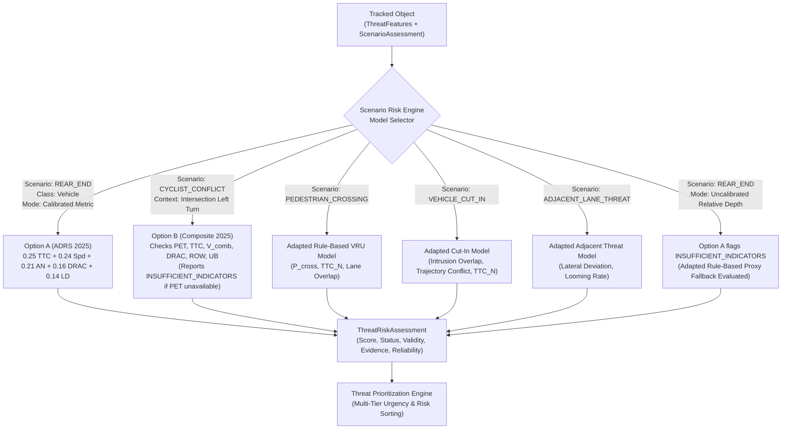

# Scientific Threat Risk Scoring and Dynamic Prioritization
## Technical Specification and Implementation Guide — Stage 3

---

## Executive Overview

This document specifies the **Weighted Risk Scoring and Dynamic Threat Prioritization Subsystem** (Stage 3 of the Priority-Based Warning System) for the Monocular ADAS System.

Building directly upon the feature extraction and scenario classification components implemented in Stage 2, this subsystem:
1. Selects an appropriate risk model for each tracked entity according to its classified interaction scenario.
2. Applies published surrogate safety models (**Option A ADRS 2025**, **Option B Composite 2025**, and **FHWA SSAM diagnostics**) using their exact mathematical formulations and coefficients without unauthorized modification or weight redistribution.
3. Normalizes physical indicators into bounded $[0.0, 1.0]$ scales using transparent, defensible empirical reference ranges and documented risk directions.
4. Distinguishes fully evaluated published models, adapted rule-based models, and unassessed threats where measurements are missing.
5. Dynamically prioritizes all relevant threats across multi-tier criteria (active conflicts, collision urgency, risk score, measurement reliability, and temporal persistence) without conflating incomparable model scales.
6. Prepares structured data structures for the directional warning and event lifecycle subsystem in Stage 4.

---

## 1. Model Registry and Published Coefficients

| Model Identifier | Model Name | Primary Scenario Scope | Published Mathematical Formulation & Coefficients | Evaluation Statuses Supported | Handling of Missing Indicators |
|:---|:---|:---|:---|:---|:---|
| `OPTION_A_ADRS_2025` | Automated Driving Risk Score (ADRS, 2025) | Mixed-traffic car-following / Lead vehicle in ego lane (`REAR_END`) | $$ADRS = 0.25 TTC_N + 0.24 Spd_N + 0.21 AN_N + 0.16 DRAC_N + 0.14 LD_N$$<br/>• TTC: 0.25<br/>• Speed std dev ($\sigma_v$): 0.24<br/>• Acceleration noise ($AN$): 0.21<br/>• DRAC: 0.16<br/>• Lateral deviation ($LD$): 0.14<br/>• Sum: 1.00 | `VALID_FULL_MODEL`<br/>`INSUFFICIENT_INDICATORS`<br/>`UNSUPPORTED_SCENARIO` | If any indicator is missing (e.g., DRAC under relative uncalibrated depth, or $\sigma_v$ with $< 3$ history samples), reports `INSUFFICIENT_INDICATORS`. **Does not redistribute weights or fabricate values.** |
| `OPTION_B_INTERSECTION_2025` | Composite Intersection Conflict Model (2025) | Left-turn vehicle–bicycle conflicts at signalized intersections (`CYCLIST_CONFLICT`) | $$CR = 0.30 PET_N + 0.30 TTC_N + 0.20 V_{\text{comb}, N} + 0.10 DRAC_N + 0.05 ROW_N + 0.05 UB_N$$<br/>• PET: 0.30<br/>• TTC: 0.30<br/>• Combined speed: 0.20<br/>• DRAC: 0.10<br/>• Right-of-way ($ROW$): 0.05<br/>• Urgent braking ($UB$): 0.05<br/>• Sum: 1.00 | `VALID_FULL_MODEL`<br/>`INSUFFICIENT_INDICATORS`<br/>`UNSUPPORTED_SCENARIO` | Post-Encroachment Time (PET) accounts for 30% of the formulation. Because a forward monocular camera lacks 2D ground-plane conflict polygon tracking, PET is unavailable. The model **strictly reports `INSUFFICIENT_INDICATORS`** without setting PET=0 or re-scaling remaining weights. |
| `FHWA_SSAM_DIAGNOSTIC` | FHWA Surrogate Safety Assessment Model (SSAM) | All vehicular and crossing conflicts | Threshold-gated surrogate classification and diagnostic severity:<br/>• Critical Conflict: $TTC < 1.5\text{ s}$<br/>• Severe Avoidance: $DR > 3.4\text{ m/s}^2$<br/>• Angle ($\theta$): Rear-End ($< 30^\circ$), Lane-Change ($30\text{–}85^\circ$), Crossing ($> 85^\circ$) | `VALID_FULL_MODEL`<br/>`INSUFFICIENT_INDICATORS` | Does not prescribe arbitrary universal linear weights. Uses threshold gating for scenario validation and severity diagnostics. |
| `RULE_BASED_ASSESSMENT` | Adapted Rule-Based Conflict Assessment | Scenarios outside published scope (`PEDESTRIAN_CROSSING`, `VEHICLE_CUT_IN`, `ADJACENT_LANE_THREAT`, `ANIMAL_CROSSING`, or uncalibrated depth fallback) | Transparent heuristic rules using valid available indicators:<br/>• Pedestrians: $0.4 P_{\text{cross}} + 0.4 TTC_N + 0.2 \text{overlap}$<br/>• Cut-In: Lateral intrusion + trajectory conflict + $TTC_N$<br/>• Adjacent: Lateral deviation + looming expansion rate | `VALID_ADAPTED_MODEL` | Clearly labeled as an unweighted / heuristic adaptation. Never presented as a published model. |

---

## 2. Scenario-to-Model Selection Architecture

The `ScenarioRiskEngine` routes each tracked object to its corresponding model:



---

## 3. Indicator Normalization Specifications

Normalizations map heterogeneous raw measurements into $[0.0, 1.0]$, preserving correct risk directionality:

| Indicator | Method | Formula | Reference Range | Risk Direction | Notes |
|:---|:---|:---|:---|:---|:---|
| **TTC** | Piecewise linear inverse | $1.0 - \frac{TTC - TTC_{\text{crit}}}{TTC_{\text{safe}} - TTC_{\text{crit}}}$ | $[1.0, 6.0]\text{ s}$ | **INVERSE** (Lower TTC $\to$ Higher Risk) | $TTC \le 1.0\text{ s} \implies 1.0$; $TTC \ge 6.0\text{ s} \implies 0.0$. Receding or negative closing speed yields `None`. |
| **PET** | Piecewise linear inverse | $1.0 - \frac{PET - PET_{\text{crit}}}{PET_{\text{safe}} - PET_{\text{crit}}}$ | $[1.0, 5.0]\text{ s}$ | **INVERSE** (Lower PET $\to$ Higher Risk) | $PET \le 1.0\text{ s} \implies 1.0$; $PET \ge 5.0\text{ s} \implies 0.0$. |
| **DRAC** | Linear saturation | $\min\left(1.0, \frac{DRAC}{DRAC_{\text{max}}}\right)$ | $[0.0, 5.0]\text{ m/s}^2$ | **DIRECT** (Higher DRAC $\to$ Higher Risk) | $5.0\text{ m/s}^2$ represents severe deceleration threshold. Returns `None` if uncalibrated relative depth. |
| **Speed Std Dev ($\sigma_v$)** | Linear saturation | $\min\left(1.0, \frac{\sigma_v}{\sigma_{v, \text{max}}}\right)$ | $[0.0, 3.0]\text{ m/s}$ | **DIRECT** (Higher $\sigma_v \to$ Higher Risk) | Measures speed fluctuation over $1.5\text{ s}$ sliding window. Requires $\ge 3$ snapshots. |
| **Acceleration Noise ($AN$)** | Linear saturation | $\min\left(1.0, \frac{AN}{AN_{\text{max}}}\right)$ | $[0.0, 2.0]\text{ m/s}^2$ | **DIRECT** (Higher $AN \to$ Higher Risk) | Root-mean-square of acceleration residuals over $1.5\text{ s}$ window. |
| **Lateral Deviation ($LD$)** | Linear saturation | $\min\left(1.0, \frac{\|cx - x_{\text{center}}\|}{W_{\text{lane}} / 2}\right)$ | $[0.0, 1.0]$ | **DIRECT** (Higher $LD \to$ Higher Risk) | Ratio relative to half-lane width. $0.0$ at center line, $1.0$ at lane boundary. |
| **Combined Speed ($V_{\text{comb}}$)** | Linear saturation | $\min\left(1.0, \frac{V_{\text{comb}}}{V_{\text{max}}}\right)$ | $[0.0, 15.0]\text{ m/s}$ | **DIRECT** (Higher Speed $\to$ Higher Risk) | Bounded by typical urban junction speed envelope ($\approx 54\text{ km/h}$). |
| **Binary Flags ($ROW, UB$)** | Binary mapping | $1.0$ if active, else $0.0$ | $[0.0, 1.0]$ | **DIRECT** | Right-of-way priority and emergency braking flags ($a < -3.5\text{ m/s}^2$). |

---

## 4. Handling Unavailable Indicators and Physical Honesty

> [!CAUTION]
> **Zero Value Fabrication Prohibition:** Under no circumstances are missing physical variables replaced with zero, or omitted terms redistributed across remaining coefficients.

1. **Option A Missing DRAC:**
   - Under relative depth mode (`distance.type: relative`), DRAC is flagged `UNAVAILABLE` because relative inverse disparity cannot yield physical $\text{m/s}^2$.
   - Option A reports `ModelEvaluationStatus.INSUFFICIENT_INDICATORS`. It does **not** redistribute DRAC's 0.16 weight across TTC, speed, or lateral deviation.
   - The engine logs explicit diagnostic reasons and optionally evaluates an adapted proxy score clearly flagged as `VALID_ADAPTED_MODEL`.
2. **Option B Missing PET:**
   - True Post-Encroachment Time requires ground-plane conflict polygon tracking.
   - Because PET is `UNAVAILABLE` in the monocular camera, Option B reports `ModelEvaluationStatus.INSUFFICIENT_INDICATORS` with explanation.
   - It does **not** set PET = 0 (which would falsely imply an instantaneous collision) and does **not** renormalize the remaining 0.70 weight.

---

## 5. Dynamic Threat Prioritization Strategy

Threats are dynamically sorted and prioritized in every processing cycle:

```
Priority Ranking Architecture
├── Tier 0: Confirmed Active Conflicts (Imminent Collision Urgency)
│   ├── REAR_END_CONFLICT
│   ├── PEDESTRIAN_CROSSING_CONFLICT
│   ├── CONFIRMED_CUT_IN
│   └── CYCLIST_CROSSING_CONFLICT / CYCLIST_LEAD_CONFLICT
├── Tier 1: Potential Conflicts and Encroachments
│   ├── REAR_END_POTENTIAL
│   ├── POTENTIAL_CUT_IN
│   ├── PEDESTRIAN_APPROACHING_PATH
│   └── ADJACENT_LANE_ENCROACHING
├── Tier 2: Stable, Parallel, or Diverging Traffic
│   ├── NO_REAR_END_CONFLICT
│   ├── ADJACENT_LANE_STABLE
│   └── PEDESTRIAN_ALONGSIDE_PATH
└── Tier 3: Unassessed / Insufficient Data (priority_rank = None)
```

### Sub-Sorting Criteria within Tiers:
1. **Collision Urgency ($\min(TTC, \text{conflict\_time})$):** Lower time to impact takes immediate priority.
2. **Risk Score:** Higher normalized score breaks ties.
3. **Reliability Grade:** `HIGH` > `MEDIUM` > `PROVISIONAL` > `UNRELIABLE`.
4. **Hysteresis Bonus:** An established primary threat receives a marginal persistence bonus ($\Delta \text{score} = -0.05$) to prevent rapid rank flapping caused by minor measurement noise.

### Discrete Threat Categorization:
- **`is_primary_threat`:** Assigned strictly to the single Rank 1 object when in Tier 0 or Tier 1 with $\text{risk\_score} \ge 0.25$.
- **Provisional Risk Levels:**
  - `HIGH`: $\text{risk\_score} \ge 0.70$
  - `MEDIUM`: $0.40 \le \text{risk\_score} < 0.70$
  - `LOW`: $\text{risk\_score} < 0.40$
  - `UNASSESSED`: If evaluation status is `INSUFFICIENT_INDICATORS` or `UNSUPPORTED_SCENARIO`.

> [!NOTE]
> These numerical boundaries are provisional operational defaults. They do not claim to represent validated collision probabilities until calibrated against annotated ground-truth driving datasets.

---

## 6. Performance Characteristics

Benchmarked across 1,000 frames with 8 active, diverse road users:
- **Total Stage 1–3 Pipeline Latency:** **0.450 ms per frame** (**0.056 ms per object**)
- **Throughput:** **2,224 FPS**
- **Overhead:** Negligible; fits comfortably within real-time 30–60 FPS video budgets.

---

## 7. Test Results

Executed via `pytest`:
- **Risk Model Unit Tests (`tests/test_threat_risk_models.py`):** **10 passed in 0.18s**
- **Prioritization Unit Tests (`tests/test_threat_prioritization.py`):** **5 passed in 11.21s**
- **Full System Regression Suite:** **96 passed across all 8 test modules with zero failures.**

